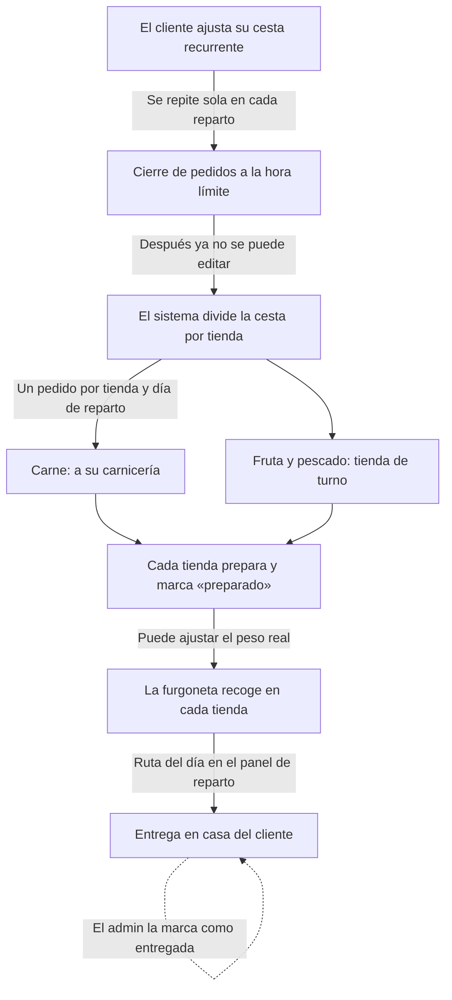

# Cistella — Especificación v1

15 oct 2026 · @Jorge

## Contexto y objetivo

Cistella es una web app de suscripción que conecta carnicerías, pescaderías y fruterías de Alzira con sus clientes y les lleva la compra a casa con reparto periódico. La v1 es un piloto con 6 tiendas para comprobar que hay clientes dispuestos a pagar la suscripción.

La motivación es el descontento con la fruta, la verdura y la carne de los supermercados (Mercadona, Consum). Cistella da acceso al comercio local sin tener que ir tienda por tienda.

Este documento es la especificación para desarrollar la v1 con Claude Code. Lo que aún no está decidido aparece al final, en Decisiones pendientes.

## Alcance de la v1

La v1 cubre el ciclo completo de un pedido recurrente en un solo municipio, Alzira, con 6 tiendas.

Entra en la v1:

- Registro de clientes y tiendas, con roles
- Catálogo de productos
- Suscripción mensual del cliente con cobro automático
- Cesta recurrente con frecuencia y día de reparto elegidos por el cliente
- Generación automática de pedidos por tienda y día de reparto
- Panel de tienda para preparar pedidos
- Panel de reparto con las recogidas y entregas del día
- Web app instalable en el móvil (PWA), en castellano

Queda para más adelante:

- App nativa en App Store y Google Play
- Optimización automática de rutas
- Valoraciones y reseñas
- Otras ciudades
- Versión en valenciano
- Facturación automática de la comisión a las tiendas

## Roles de usuario

La app tiene tres roles; en la v1 el reparto lo gestiona el propio admin.

| Rol | Quién es | Qué hace en la app |
| --- | --- | --- |
| Cliente | Vecino de Alzira suscrito | Gestiona su suscripción, su cesta y su dirección |
| Tienda | Carnicería, pescadería o frutería del piloto | Gestiona sus productos y prepara los pedidos que le llegan |
| Admin | Equipo de Cistella | Da de alta tiendas, configura repartos y rotaciones, organiza el reparto del día |

## Tiendas del piloto y modelo de negocio

El piloto arranca con 6 tiendas, 2 de cada tipo. Cistella cobra 20 €/mes al cliente y un porcentaje de cada pedido a la tienda.

| Tipo | Tiendas | Cómo las ve el cliente |
| --- | --- | --- |
| Carnicería | Oskiñez, Carnicería Reino | Cada producto indica de qué carnicería es |
| Pescadería | Pescados Miguel Ferrer, Pescados Tomás | Catálogo unificado, sin elegir tienda |
| Frutería | Las 2 mejor valoradas de Alzira (por concretar) | Catálogo unificado, sin elegir tienda |

Ingresos:

- Suscripción del cliente: 20 €/mes, con cobro automático.
- Comisión a la tienda: un porcentaje de cada pedido (por fijar).

La app debe guardar lo vendido por cada tienda para poder calcular la comisión, aunque en la v1 se facture a mano.

## Reglas del catálogo

La carne se compra por carnicería; la fruta, la verdura y el pescado se compran a Cistella y el sistema asigna la tienda.

- **Carne:** cada producto pertenece a una carnicería y el cliente lo ve, porque cada una tiene sus embutidos y hamburguesas. Una cesta puede llevar productos de las dos carnicerías.
- **Fruta, verdura y pescado:** un catálogo único por categoría. El cliente no elige tienda.
- **Rotación:** en cada día de reparto, la fruta va a una frutería y el pescado a una pescadería, alternando entre las dos de cada tipo para que todas reciban pedidos. El admin configura la rotación.
- **Productos al peso:** cada producto guarda su unidad (kg, unidad o bandeja) y su precio por unidad. La tienda puede indicar el peso real al prepararlo.
- **Disponibilidad:** cada tienda marca qué productos tiene. En el catálogo unificado, un producto solo se sirve si la tienda de turno lo tiene.

Propuesta para la v1: el admin gestiona el catálogo unificado (nombre, foto, precio, unidad) y cada frutería o pescadería solo marca disponibilidad. Las carnicerías gestionan sus propios productos.

## Funcionalidades por rol

### Cliente

- Registro e inicio de sesión con email.
- Dirección de entrega, limitada a Alzira (CP 46600).
- Alta, pausa y baja de la suscripción de 20 €/mes.
- Elegir frecuencia y día de reparto.
- Montar una cesta recurrente que se repite sola en cada reparto, editable hasta la hora de cierre.
- Ver el próximo pedido y el historial.

### Tienda

- Inicio de sesión; la cuenta la crea el admin.
- Carnicerías: crear y editar sus productos (nombre, foto, precio, unidad, disponible o no).
- Fruterías y pescaderías: marcar la disponibilidad del catálogo unificado.
- Ver los pedidos asignados por día de reparto, con cantidades por producto y por cliente.
- Marcar cada pedido como preparado e indicar el peso real si cambia.
- Resumen mensual de ventas y comisión.

### Admin

- Alta y edición de tiendas.
- Gestión del catálogo unificado de fruta, verdura y pescado.
- Configurar días de reparto, hora de cierre y rotación de tiendas.
- Vista del reparto del día: recogidas por tienda y entregas con dirección y teléfono.
- Marcar entregas como hechas.
- Ver clientes y el estado de su suscripción.

## Flujo de un pedido

Cada cesta se divide en un pedido por tienda y vuelve a juntarse en la furgoneta antes de llegar al cliente.

La carne va a la carnicería de cada producto; la fruta y el pescado, a la tienda de turno según la rotación. Cuándo y cómo se cobran los productos está en Decisiones pendientes.

## Modelo de datos orientativo

Es una propuesta de partida; Claude Code puede ajustarla al implementar.

| Tabla | Campos principales | Notas |
| --- | --- | --- |
| profiles | rol (cliente, tienda, admin), nombre, teléfono, dirección, CP | Enlazada a Supabase Auth |
| shops | nombre, tipo (carnicería, pescadería, frutería), activa | Una cuenta de tienda por shop |
| products | shop_id, categoría, nombre, foto, precio, unidad, activo | shop_id solo en carne; fruta y pescado van sin tienda |
| shop_availability | shop_id, product_id, disponible | Disponibilidad del catálogo unificado |
| subscriptions | cliente, estado, stripe_subscription_id, frecuencia, día de reparto | |
| basket_items | cliente, product_id, cantidad | La cesta recurrente |
| delivery_days | fecha, hora de cierre, frutería de turno, pescadería de turno | Guarda la rotación |
| orders | cliente, delivery_day, estado, importe | Un pedido del cliente por reparto |
| shop_orders | order_id, shop_id, estado (pendiente, preparado, recogido) | La parte del pedido de cada tienda |
| order_items | shop_order_id, product_id, cantidad pedida, cantidad real, precio | |

## Stack y requisitos técnicos

Un stack sin servidores propios, para que un equipo pequeño pueda mantenerlo.

| Pieza | Elección | Para qué |
| --- | --- | --- |
| Web y API | Next.js (App Router) + TypeScript | La app y sus rutas de servidor |
| Estilos | Tailwind CSS | Interfaz mobile-first |
| Datos y usuarios | Supabase (Postgres, Auth, Storage) | Base de datos, login y fotos de productos |
| Pagos | Stripe Billing | Suscripción de 20 €/mes en euros |
| Despliegue | Vercel | Publicar la web |
| PWA | Manifest + service worker | Instalable en el móvil |

Requisitos:

- Mobile-first: clientes y tiendas lo usarán sobre todo desde el móvil.
- Permisos por rol con Row Level Security de Supabase: una tienda solo ve sus productos y sus pedidos.
- Interfaz en castellano y precios en euros con IVA incluido.
- RGPD: política de privacidad y solo los datos necesarios (nombre, email, teléfono, dirección).
- Claves en variables de entorno (.env), nunca en el repositorio.

## Instrucciones para Claude Code

Desarrolla la v1 por fases: en cada una, propón un plan, espera confirmación y después implementa y prueba. Guarda este documento como SPEC.md en la raíz del repositorio.

1. **Base del proyecto:** Next.js + Supabase, login y roles (cliente, tienda, admin).
2. **Tiendas y catálogo:** alta de tiendas, productos de carnicería, catálogo unificado y disponibilidad.
3. **Suscripción y cesta:** Stripe en modo test, alta y baja de la suscripción, cesta recurrente, frecuencia y día de reparto.
4. **Pedidos:** días de reparto, hora de cierre, rotación y generación automática de pedidos por tienda.
5. **Paneles:** panel de tienda para preparar pedidos y panel de reparto con recogidas y entregas.
6. **PWA y pulido:** instalable en el móvil, textos, estados vacíos y mensajes de error.

Normas de trabajo:

- Crea datos de ejemplo (seed) con las 6 tiendas del piloto.
- Stripe siempre en modo test hasta el lanzamiento.
- Commits pequeños, uno por funcionalidad.
- Si una regla de negocio no está clara, pregunta antes de decidir; revisa Decisiones pendientes.
- Tests para la generación de pedidos y la rotación de tiendas.

## Decisiones pendientes

Afectan a la lógica de pedidos y pagos; conviene cerrarlas antes de las fases 3 y 4.

- Porcentaje de comisión por pedido para las tiendas.
- Cómo se cobran los productos: ¿aparte de la cuota, en cada pedido?, ¿con el peso real después de preparar?
- Quién fija el precio del catálogo unificado de fruta y pescado, y qué pasa si las dos tiendas tienen precios distintos.
- Días de reparto y hora límite para editar la cesta.
- Frecuencias disponibles (semanal, quincenal, mensual).
- Qué 2 fruterías entran en el piloto.
- Verdura: ¿la sirven las fruterías o entra una verdulería aparte?
- Zona de reparto: ¿todo el término de Alzira o solo el casco urbano?
- Pedido mínimo por reparto y qué hacer si el cliente no está en casa.

> El estado de cada decisión (resuelta o con valor provisional configurable) está en [DECISIONES.md](./DECISIONES.md).
